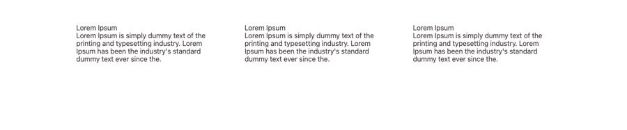
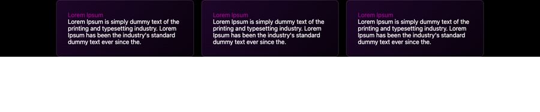

# Benefícios

**Propósito:** variações de seção do tipo "Benefícios" prontas para importar no Elementor.  
**Quando usar:** ao montar a dobra correspondente de uma página nova.  
**Relacionados:** [catalogo-secoes.md](../catalogo-secoes.md), [estrutura-de-pagina.md](<../../../copy/estrutura-de-pagina.md>), [anatomia-json-elementor.md](<../../anatomia-json-elementor.md>)

Importar: no Elementor, pasta de templates > Importar e escolher o `.json`; ou abrir o `.json`, copiar e usar "Colar de outro site" com os `content` convertidos. Os textos são Lorem Ipsum de modelo. O `.jpg` é uma pré-visualização aproximada gerada por `scripts/elementor-para-preview.py` (widgets de addons aparecem como caixa pontilhada).

## cards-texto-3-colunas-sem-fundo

- **Arquivo:** [cards-texto-3-colunas-sem-fundo.json](cards-texto-3-colunas-sem-fundo.json) (título no export: "CARD 02")
- **Visual:** Três colunas de título curto + parágrafo, sem fundo nem borda.
- **Quando usar:** Benefícios ou diferenciais em formato minimalista.
- **Layout:** 3 colunas · **Estilo:** claro · **Cor dominante:** `transparente` · **Nicho:** genérico
- **Widgets:** icon-box (3), container (1)

## cards-escuros-borda-roxa-3-colunas

- **Arquivo:** [cards-escuros-borda-roxa-3-colunas.json](cards-escuros-borda-roxa-3-colunas.json) (título no export: "card 06")
- **Visual:** Fundo preto; 3 cards escuros com borda roxa, título roxo e texto branco.
- **Quando usar:** Benefícios em página escura (agência, infoproduto).
- **Layout:** 3 colunas · **Estilo:** escuro · **Cor dominante:** `#000000` · **Nicho:** infoproduto / agência
- **Widgets:** container (4), icon-box (3)
