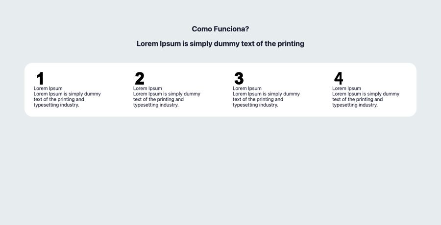

# Como funciona

**Propósito:** variações de seção do tipo "Como funciona" prontas para importar no Elementor.  
**Quando usar:** ao montar a dobra correspondente de uma página nova.  
**Relacionados:** [catalogo-secoes.md](../catalogo-secoes.md), [estrutura-de-pagina.md](<../../../copy/estrutura-de-pagina.md>), [anatomia-json-elementor.md](<../../anatomia-json-elementor.md>)

Importar: no Elementor, pasta de templates > Importar e escolher o `.json`; ou abrir o `.json`, copiar e usar "Colar de outro site" com os `content` convertidos. Os textos são Lorem Ipsum de modelo. O `.jpg` é uma pré-visualização aproximada gerada por `scripts/elementor-para-preview.py` (widgets de addons aparecem como caixa pontilhada).

## como-funciona-4-passos-numerados-faixa-branca

- **Arquivo:** [como-funciona-4-passos-numerados-faixa-branca.json](como-funciona-4-passos-numerados-faixa-branca.json) (título no export: "CARD 26")
- **Visual:** Fundo cinza-claro; título e sub centralizados, faixa branca arredondada com 4 passos numerados (1, 2, 3, 4) em colunas.
- **Quando usar:** Passo a passo do atendimento (captação).
- **Layout:** 4 colunas numeradas · **Estilo:** claro · **Cor dominante:** `#E7ECEF` · **Nicho:** genérico
- **Widgets:** container (6), icon-box (4), heading (2)
