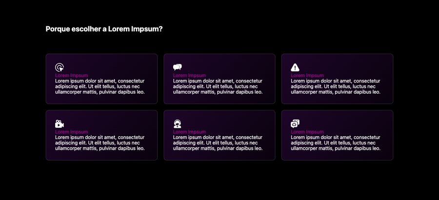

# Diferenciais / por que escolher

**Propósito:** variações de seção do tipo "Diferenciais / por que escolher" prontas para importar no Elementor.  
**Quando usar:** ao montar a dobra correspondente de uma página nova.  
**Relacionados:** [catalogo-secoes.md](../catalogo-secoes.md), [estrutura-de-pagina.md](<../../../copy/estrutura-de-pagina.md>), [anatomia-json-elementor.md](<../../anatomia-json-elementor.md>)

Importar: no Elementor, pasta de templates > Importar e escolher o `.json`; ou abrir o `.json`, copiar e usar "Colar de outro site" com os `content` convertidos. Os textos são Lorem Ipsum de modelo. O `.jpg` é uma pré-visualização aproximada gerada por `scripts/elementor-para-preview.py` (widgets de addons aparecem como caixa pontilhada).

## diferenciais-6-cards-icone-fundo-preto

- **Arquivo:** [diferenciais-6-cards-icone-fundo-preto.json](diferenciais-6-cards-icone-fundo-preto.json) (título no export: "card 11")
- **Visual:** Fundo preto; título "Porque escolher a ...?" e grid 3x2 de cards escuros com ícone branco, título roxo e texto.
- **Quando usar:** Seção "por que escolher" em página escura.
- **Layout:** grid 3x2 · **Estilo:** escuro · **Cor dominante:** `#000000` · **Nicho:** agência / infoproduto
- **Widgets:** container (9), icon-box (6), heading (1), divider (1)
- **Atenção:** o JSON original tinha acentos quebrados (ex.: "Cápsulas"); esta cópia foi corrigida.
