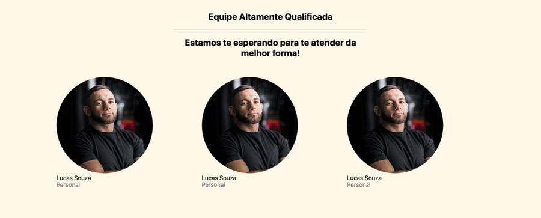
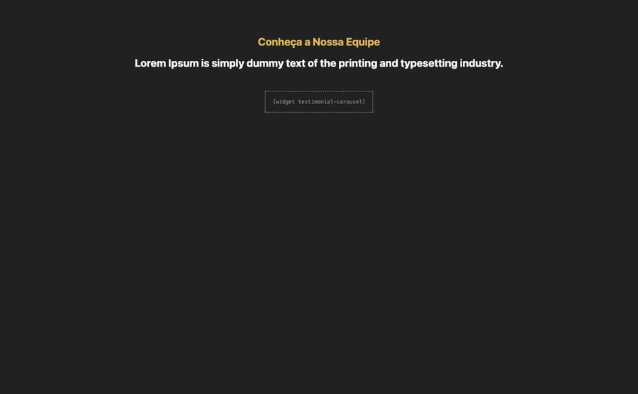

# Equipe

**Propósito:** variações de seção do tipo "Equipe" prontas para importar no Elementor.  
**Quando usar:** ao montar a dobra correspondente de uma página nova.  
**Relacionados:** [catalogo-secoes.md](../catalogo-secoes.md), [estrutura-de-pagina.md](<../../../copy/estrutura-de-pagina.md>), [anatomia-json-elementor.md](<../../anatomia-json-elementor.md>)

Importar: no Elementor, pasta de templates > Importar e escolher o `.json`; ou abrir o `.json`, copiar e usar "Colar de outro site" com os `content` convertidos. Os textos são Lorem Ipsum de modelo. O `.jpg` é uma pré-visualização aproximada gerada por `scripts/elementor-para-preview.py` (widgets de addons aparecem como caixa pontilhada).

## equipe-fotos-redondas-3-colunas

- **Arquivo:** [equipe-fotos-redondas-3-colunas.json](equipe-fotos-redondas-3-colunas.json) (título no export: "equipe 01")
- **Visual:** Fundo creme; título "Equipe Altamente Qualificada", sub e 3 fotos redondas com nome e cargo.
- **Quando usar:** Apresentar equipe de clínica, estúdio ou escritório.
- **Layout:** 3 colunas · **Estilo:** claro · **Cor dominante:** `#FFF7E8` · **Nicho:** genérico
- **Widgets:** container (3), image-box (3), heading (2), divider (1)

## equipe-carrossel-fundo-escuro

- **Arquivo:** [equipe-carrossel-fundo-escuro.json](equipe-carrossel-fundo-escuro.json) (título no export: "equipe 02")
- **Visual:** Fundo escuro; título dourado "Conheça a Nossa Equipe", sub e carrossel de cards (testimonial-carousel usado como equipe).
- **Quando usar:** Equipe grande em carrossel.
- **Layout:** carrossel · **Estilo:** escuro · **Cor dominante:** `#222122` · **Nicho:** genérico
- **Widgets:** heading (2), container (1), testimonial-carousel (1)
