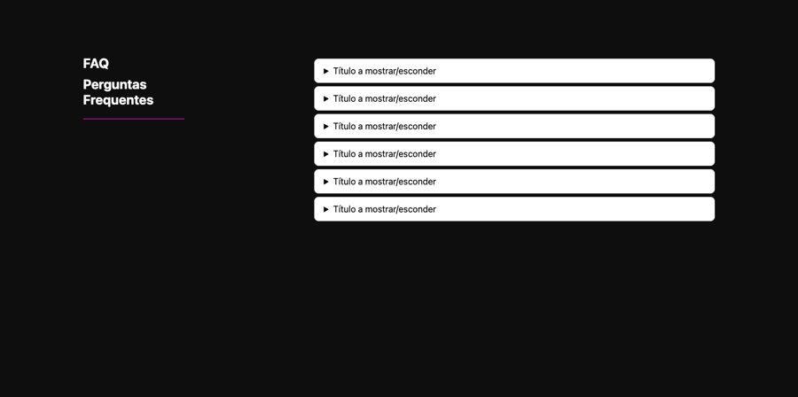
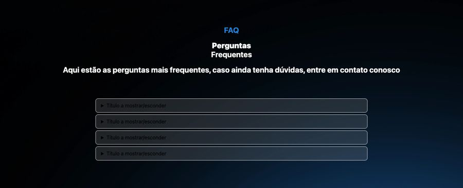
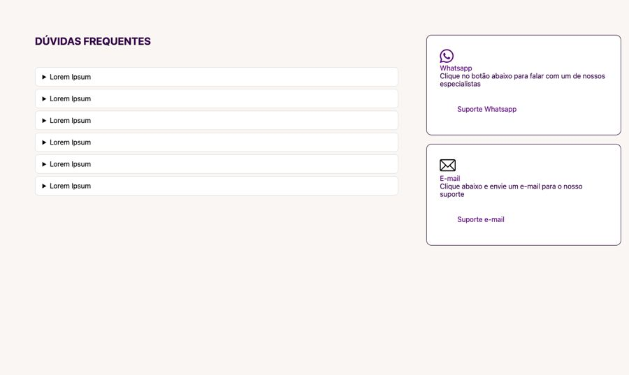

# FAQ

**Propósito:** variações de seção do tipo "FAQ" prontas para importar no Elementor.  
**Quando usar:** ao montar a dobra correspondente de uma página nova.  
**Relacionados:** [catalogo-secoes.md](../catalogo-secoes.md), [estrutura-de-pagina.md](<../../../copy/estrutura-de-pagina.md>), [anatomia-json-elementor.md](<../../anatomia-json-elementor.md>)

Importar: no Elementor, pasta de templates > Importar e escolher o `.json`; ou abrir o `.json`, copiar e usar "Colar de outro site" com os `content` convertidos. Os textos são Lorem Ipsum de modelo. O `.jpg` é uma pré-visualização aproximada gerada por `scripts/elementor-para-preview.py` (widgets de addons aparecem como caixa pontilhada).

## faq-titulo-esquerda-acordeao-direita-escuro

- **Arquivo:** [faq-titulo-esquerda-acordeao-direita-escuro.json](faq-titulo-esquerda-acordeao-direita-escuro.json) (título no export: "faq1")
- **Visual:** Fundo preto; "FAQ / Perguntas Frequentes" à esquerda com filete roxo e acordeão branco de 6 itens à direita.
- **Quando usar:** FAQ em página escura (padrão título à esquerda da casa).
- **Layout:** duas colunas · **Estilo:** escuro · **Cor dominante:** `#0E0E0E` · **Nicho:** genérico
- **Widgets:** container (2), heading (2), divider (1), toggle (1)

## faq-centralizado-fundo-escuro-azul

- **Arquivo:** [faq-centralizado-fundo-escuro-azul.json](faq-centralizado-fundo-escuro-azul.json) (título no export: "faq2")
- **Visual:** Fundo escuro com brilho azul; rótulo "FAQ" azul, título e sub centralizados e acordeão translúcido de 4 itens.
- **Quando usar:** FAQ em página escura tecnológica.
- **Layout:** centralizado · **Estilo:** escuro · **Cor dominante:** `#000000` · **Nicho:** infoproduto / tecnologia
- **Widgets:** heading (3), container (1), toggle (1)

## faq-com-cards-de-suporte-whatsapp-email

- **Arquivo:** [faq-com-cards-de-suporte-whatsapp-email.json](faq-com-cards-de-suporte-whatsapp-email.json) (título no export: "FAQ 10")
- **Visual:** Fundo creme; "DÚVIDAS FREQUENTES" com acordeão à esquerda e dois cards de suporte (WhatsApp e e-mail) com botão à direita.
- **Quando usar:** FAQ que já oferece contato (usado em goncont e rp-vision).
- **Layout:** duas colunas (FAQ | contato) · **Estilo:** claro · **Cor dominante:** `#FAF6F3` · **Nicho:** serviços B2B
- **Widgets:** container (5), icon-box (2), button (2), heading (1), toggle (1)
