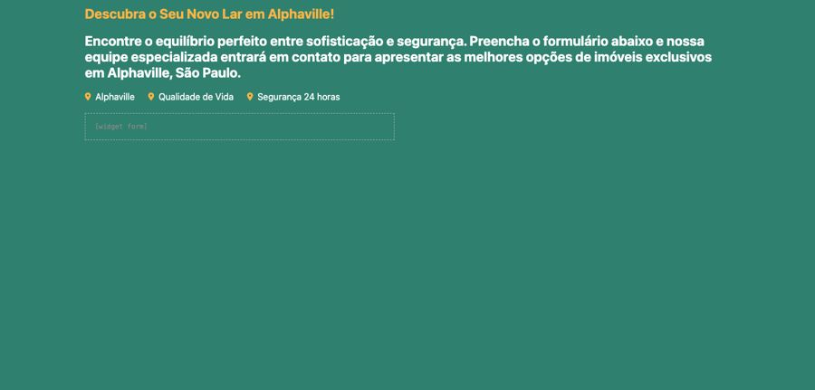
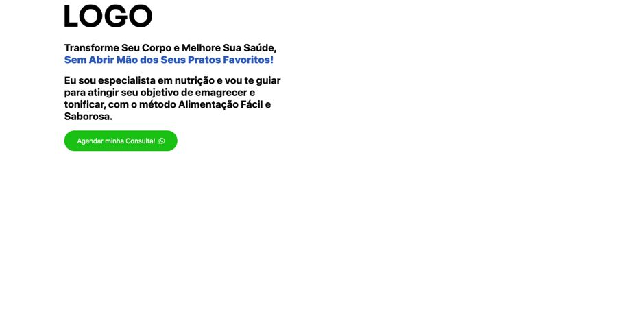
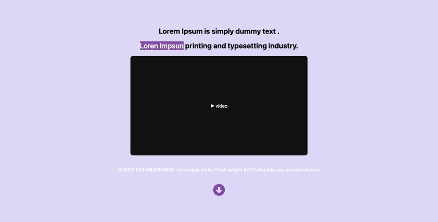
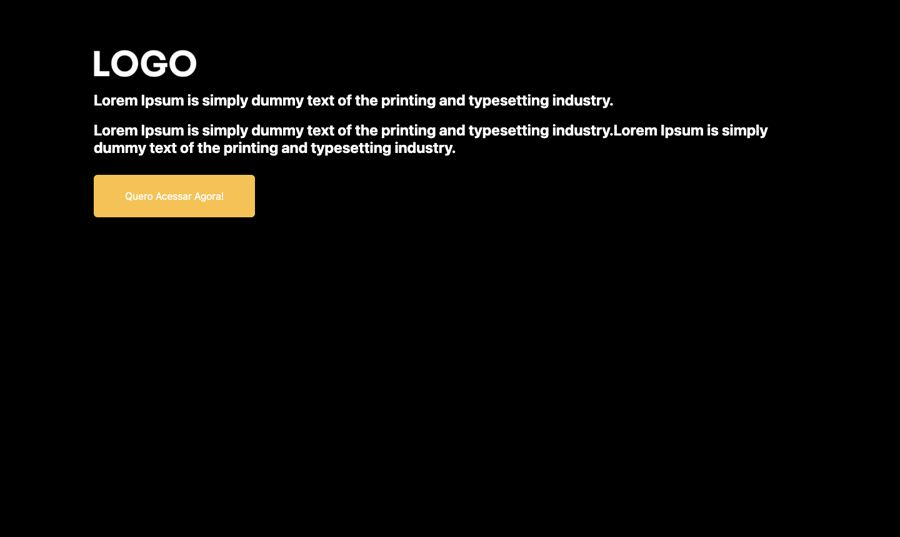
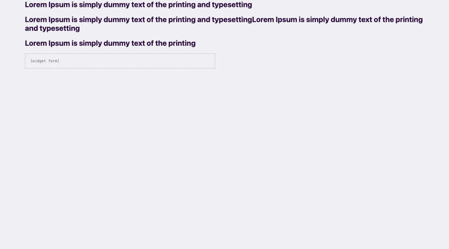

# Primeira dobra (hero)

**Propósito:** variações de seção do tipo "Primeira dobra (hero)" prontas para importar no Elementor.  
**Quando usar:** ao montar a dobra correspondente de uma página nova.  
**Relacionados:** [catalogo-secoes.md](../catalogo-secoes.md), [estrutura-de-pagina.md](<../../../copy/estrutura-de-pagina.md>), [anatomia-json-elementor.md](<../../anatomia-json-elementor.md>)

Importar: no Elementor, pasta de templates > Importar e escolher o `.json`; ou abrir o `.json`, copiar e usar "Colar de outro site" com os `content` convertidos. Os textos são Lorem Ipsum de modelo. O `.jpg` é uma pré-visualização aproximada gerada por `scripts/elementor-para-preview.py` (widgets de addons aparecem como caixa pontilhada).

## hero-formulario-imobiliario-verde

- **Arquivo:** [hero-formulario-imobiliario-verde.json](hero-formulario-imobiliario-verde.json) (título no export: "Primeira dobra - Dobra 01")
- **Visual:** Fundo verde-esmeralda; headline amarela "Descubra o Seu Novo Lar em Alphaville!", parágrafo branco, 3 selos com ícone de pin (bairro, qualidade de vida, segurança 24h) e formulário embaixo.
- **Quando usar:** Lançamento imobiliário ou captação com formulário logo na primeira dobra.
- **Layout:** coluna única, formulário abaixo · **Estilo:** escuro · **Cor dominante:** `#2F806F` · **Nicho:** imobiliário
- **Widgets:** heading (2), container (1), icon-list (1), form (1)

## hero-logo-headline-destaque-botao-whatsapp

- **Arquivo:** [hero-logo-headline-destaque-botao-whatsapp.json](hero-logo-headline-destaque-botao-whatsapp.json) (título no export: "Inicial - Dobra 02")
- **Visual:** Fundo branco; logo no topo, headline com segunda linha em azul ("Sem Abrir Mão dos Seus Pratos Favoritos!"), parágrafo em negrito e botão verde com ícone de WhatsApp.
- **Quando usar:** Captação de profissional de saúde (nutrição, estética) com CTA direto para WhatsApp.
- **Layout:** coluna à esquerda (imagem de fundo à direita) · **Estilo:** claro · **Cor dominante:** `#FFFFFF` · **Nicho:** saúde / nutrição
- **Widgets:** container (2), heading (2), image (1), button (1)

## hero-vsl-video-central-lilas

- **Arquivo:** [hero-vsl-video-central-lilas.json](hero-vsl-video-central-lilas.json) (título no export: "Inicial - dobra 05")
- **Visual:** Fundo lilás claro; título centralizado com palavra em marca-texto roxo, vídeo (VSL) no centro, botão abaixo e seta circular para rolar.
- **Quando usar:** Página de vendas com VSL logo no topo.
- **Layout:** centralizado · **Estilo:** claro · **Cor dominante:** `#DCD6F7` · **Nicho:** infoproduto
- **Widgets:** heading (2), container (1), image (1), video (1), button (1), icon (1)

## hero-escuro-logo-botao-amarelo

- **Arquivo:** [hero-escuro-logo-botao-amarelo.json](hero-escuro-logo-botao-amarelo.json) (título no export: "inicial - dobra 12")
- **Visual:** Fundo preto; logo grande branca, headline e sub em branco e botão amarelo "Quero Acessar Agora!".
- **Quando usar:** Página de vendas escura e direta.
- **Layout:** coluna à esquerda · **Estilo:** escuro · **Cor dominante:** `#000000` · **Nicho:** infoproduto
- **Widgets:** heading (2), container (1), image (1), button (1)

## hero-formulario-fundo-claro

- **Arquivo:** [hero-formulario-fundo-claro.json](hero-formulario-fundo-claro.json) (título no export: "inicial - dobra 17")
- **Visual:** Fundo cinza-lilás muito claro; três linhas de título em roxo escuro e formulário logo abaixo.
- **Quando usar:** Captação com formulário (lead) em vez de WhatsApp.
- **Layout:** coluna à esquerda · **Estilo:** claro · **Cor dominante:** `#F0EFF4` · **Nicho:** genérico
- **Widgets:** heading (3), container (1), form (1)
