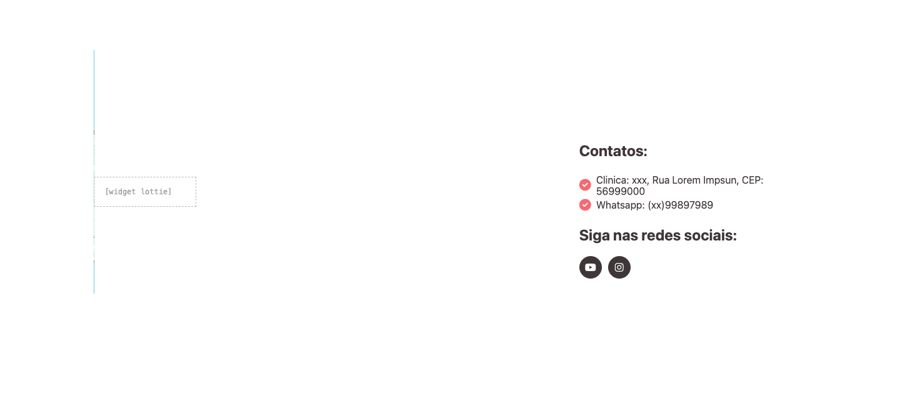
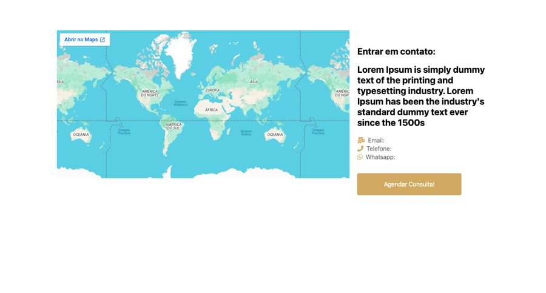
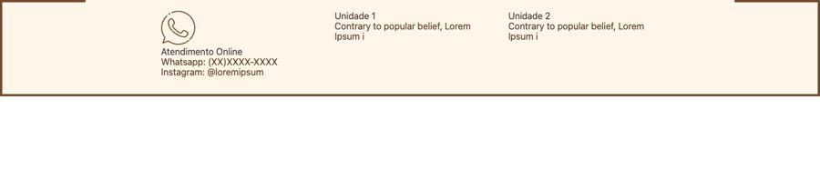
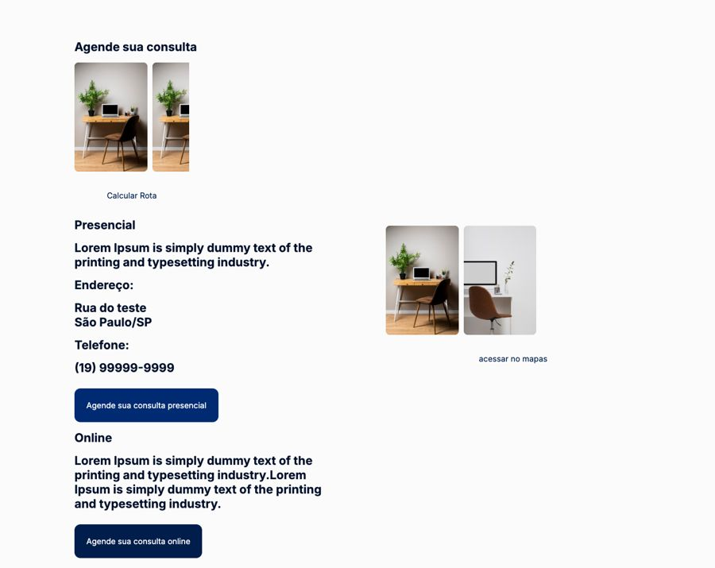

# Localização e contato

**Propósito:** variações de seção do tipo "Localização e contato" prontas para importar no Elementor.  
**Quando usar:** ao montar a dobra correspondente de uma página nova.  
**Relacionados:** [catalogo-secoes.md](../catalogo-secoes.md), [estrutura-de-pagina.md](<../../../copy/estrutura-de-pagina.md>), [anatomia-json-elementor.md](<../../anatomia-json-elementor.md>)

Importar: no Elementor, pasta de templates > Importar e escolher o `.json`; ou abrir o `.json`, copiar e usar "Colar de outro site" com os `content` convertidos. Os textos são Lorem Ipsum de modelo. O `.jpg` é uma pré-visualização aproximada gerada por `scripts/elementor-para-preview.py` (widgets de addons aparecem como caixa pontilhada).

## localizacao-mapa-esquerda-contatos-redes

- **Arquivo:** [localizacao-mapa-esquerda-contatos-redes.json](localizacao-mapa-esquerda-contatos-redes.json) (título no export: "loc 02")
- **Visual:** Mapa do Google à esquerda; "Contatos:" com endereço e WhatsApp em lista com check e redes sociais à direita.
- **Quando usar:** Clínicas e consultórios com endereço físico.
- **Layout:** duas colunas (mapa | contatos) · **Estilo:** claro · **Cor dominante:** `#FFFFFF` · **Nicho:** saúde / odonto
- **Widgets:** container (2), heading (2), google_maps (1), image (1), icon-list (1), social-icons (1), lottie (1)

## localizacao-mapa-contato-botao-dourado

- **Arquivo:** [localizacao-mapa-contato-botao-dourado.json](localizacao-mapa-contato-botao-dourado.json) (título no export: "loc 03")
- **Visual:** Mapa grande à esquerda; "Entrar em contato" com texto, e-mail, telefone e WhatsApp e botão dourado à direita.
- **Quando usar:** Escritórios e clínicas premium.
- **Layout:** duas colunas · **Estilo:** claro · **Cor dominante:** `#FFFFFF` · **Nicho:** genérico
- **Widgets:** container (2), heading (2), google_maps (1), icon-list (1), button (1)

## localizacao-faixa-online-e-unidades

- **Arquivo:** [localizacao-faixa-online-e-unidades.json](localizacao-faixa-online-e-unidades.json) (título no export: "loc 05")
- **Visual:** Faixa creme com borda marrom; três colunas: atendimento online (WhatsApp, Instagram), unidade 1 e unidade 2.
- **Quando usar:** Profissional com mais de uma unidade (usado em psi-julia-valdetaro).
- **Layout:** 3 colunas · **Estilo:** claro · **Cor dominante:** `#FFF5E8` · **Nicho:** psicologia
- **Widgets:** container (3), icon-box (3), heading (1), divider (1)

## localizacao-presencial-e-online-com-fotos

- **Arquivo:** [localizacao-presencial-e-online-com-fotos.json](localizacao-presencial-e-online-com-fotos.json) (título no export: "localizacao 06")
- **Visual:** Fundo quase branco; "Agende sua consulta" com blocos Presencial (endereço, telefone, botão) e Online (texto, botão) e fotos do consultório, link "acessar no mapas".
- **Quando usar:** Médicos com atendimento presencial e online (usado em saude-pedro-camargo).
- **Layout:** duas colunas · **Estilo:** claro · **Cor dominante:** `#FBFBFB` · **Nicho:** saúde
- **Widgets:** heading (9), container (4), button (4), image-carousel (2)
