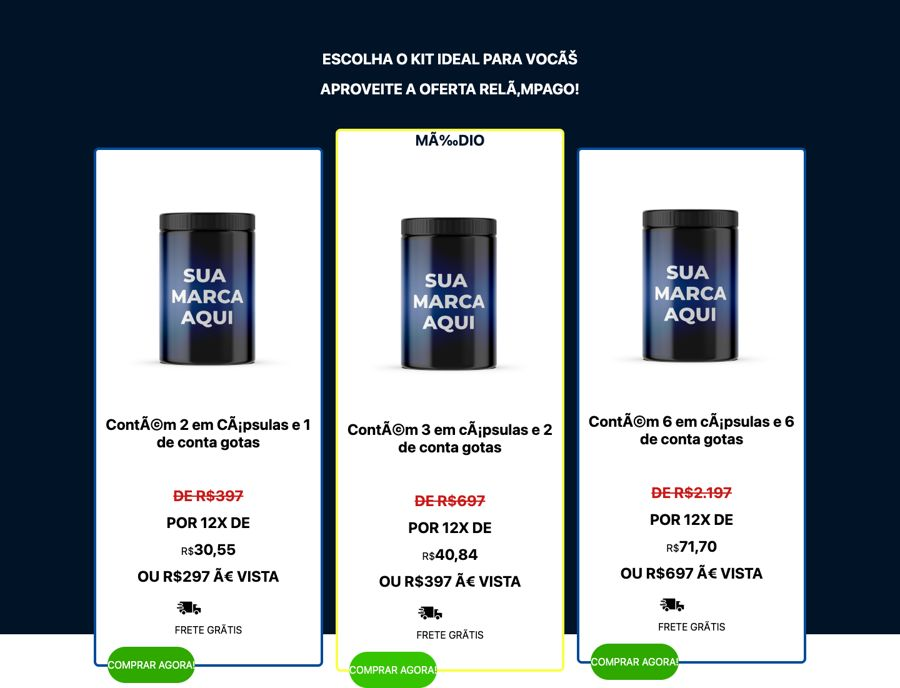
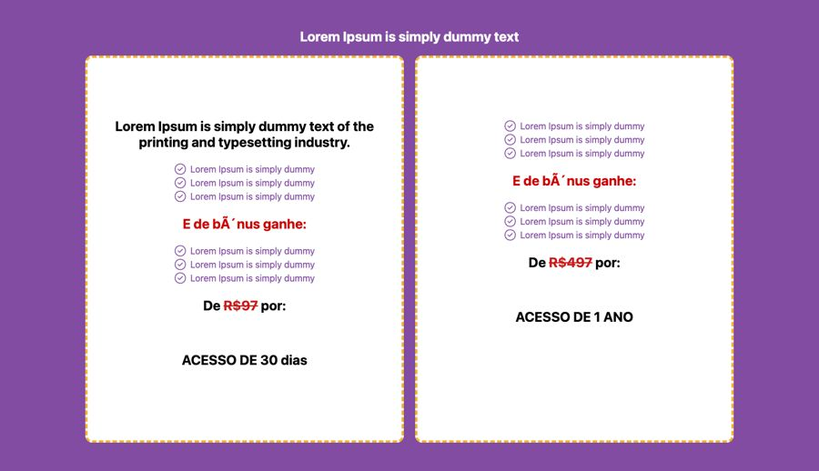
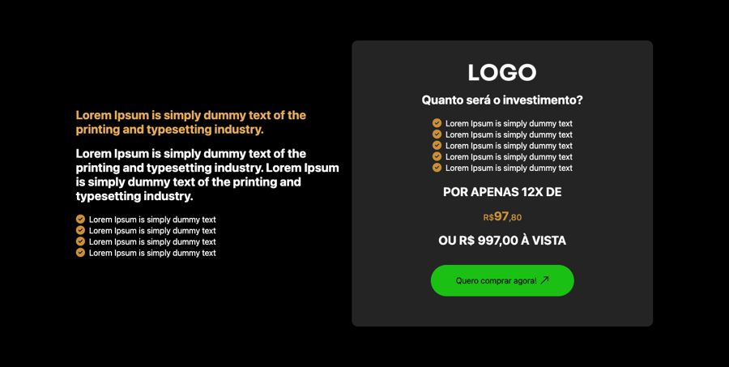
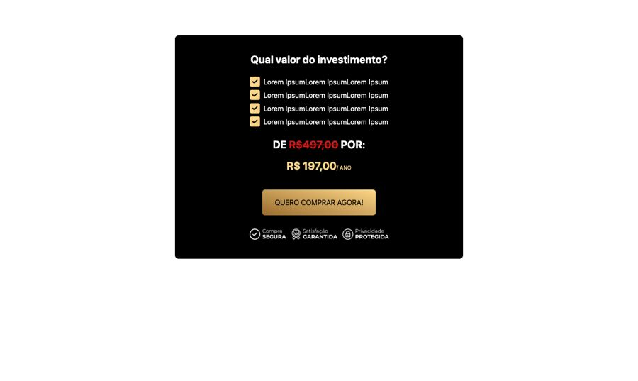
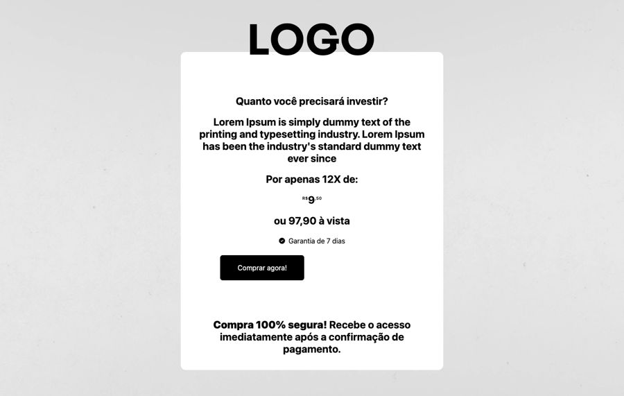
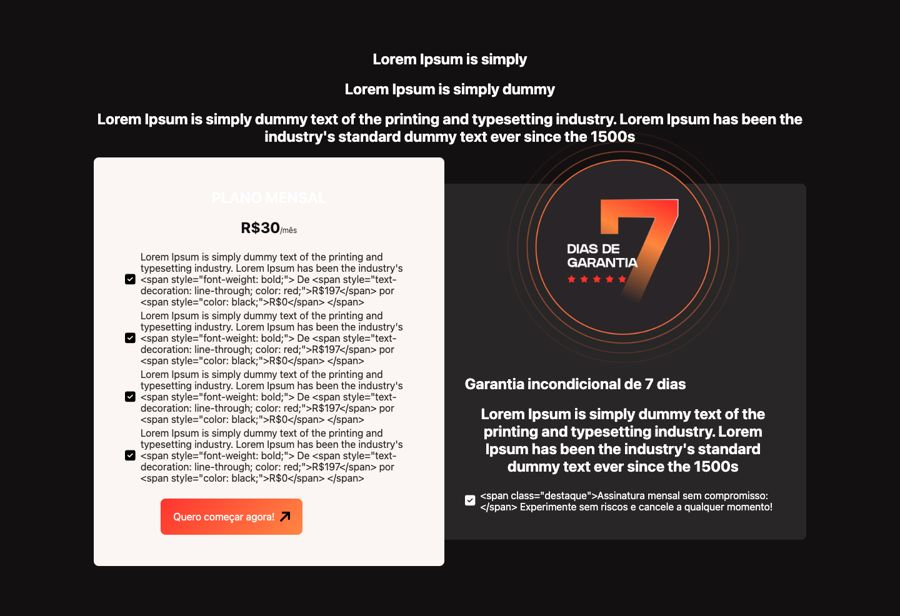

# Oferta e preço (inclui garantia)

**Propósito:** variações de seção do tipo "Oferta e preço (inclui garantia)" prontas para importar no Elementor.  
**Quando usar:** ao montar a dobra correspondente de uma página nova.  
**Relacionados:** [catalogo-secoes.md](../catalogo-secoes.md), [estrutura-de-pagina.md](<../../../copy/estrutura-de-pagina.md>), [anatomia-json-elementor.md](<../../anatomia-json-elementor.md>)

Importar: no Elementor, pasta de templates > Importar e escolher o `.json`; ou abrir o `.json`, copiar e usar "Colar de outro site" com os `content` convertidos. Os textos são Lorem Ipsum de modelo. O `.jpg` é uma pré-visualização aproximada gerada por `scripts/elementor-para-preview.py` (widgets de addons aparecem como caixa pontilhada).

## oferta-3-kits-produto-fisico

- **Arquivo:** [oferta-3-kits-produto-fisico.json](oferta-3-kits-produto-fisico.json) (título no export: "oferta 02")
- **Visual:** Fundo navy; título "Escolha o kit ideal", 3 cards brancos com frasco, preço riscado, 12x e à vista, frete grátis e botão verde; card do meio destacado em amarelo ("MAIS VENDIDO"/"MÉDIO").
- **Quando usar:** Produto físico com kits (suplemento, cosmético).
- **Layout:** 3 cards de preço · **Estilo:** escuro · **Cor dominante:** `#001327` · **Nicho:** produto físico
- **Widgets:** heading (24), container (5), image (3), icon-box (3), button (3)
- **Atenção:** o JSON original tinha acentos quebrados (ex.: "Cápsulas"); esta cópia foi corrigida.

## oferta-2-planos-com-bonus-fundo-roxo

- **Arquivo:** [oferta-2-planos-com-bonus-fundo-roxo.json](oferta-2-planos-com-bonus-fundo-roxo.json) (título no export: "oferta 04")
- **Visual:** Fundo roxo; 2 cards brancos com borda tracejada amarela, lista de itens, "E de bônus ganhe:", preço riscado e acesso (30 dias x 1 ano).
- **Quando usar:** Infoproduto com dois planos de acesso.
- **Layout:** 2 cards de preço · **Estilo:** escuro · **Cor dominante:** `#814CA2` · **Nicho:** infoproduto
- **Widgets:** heading (12), container (4), icon-list (4), button (2)
- **Atenção:** o JSON original tinha acentos quebrados (ex.: "Cápsulas"); esta cópia foi corrigida.

## oferta-texto-esquerda-card-preco-escuro

- **Arquivo:** [oferta-texto-esquerda-card-preco-escuro.json](oferta-texto-esquerda-card-preco-escuro.json) (título no export: "oferta 06")
- **Visual:** Fundo preto; texto e checks à esquerda e card cinza-escuro à direita com logo, lista, "POR APENAS 12X DE R$97,80", à vista e botão verde.
- **Quando usar:** Página de vendas escura com oferta única.
- **Layout:** duas colunas (argumento | card) · **Estilo:** escuro · **Cor dominante:** `#000000` · **Nicho:** infoproduto
- **Widgets:** heading (6), container (3), icon-list (2), image (1), button (1)

## oferta-card-preto-ancoragem-dourada

- **Arquivo:** [oferta-card-preto-ancoragem-dourada.json](oferta-card-preto-ancoragem-dourada.json) (título no export: "oferta 09")
- **Visual:** Card preto centralizado: "Qual valor do investimento?", 4 checks dourados, "DE R$497 POR R$197/ANO" e botão dourado com selos de compra segura.
- **Quando usar:** Oferta única com ancoragem simples.
- **Layout:** card centralizado · **Estilo:** escuro sobre claro · **Cor dominante:** `#FFFFFF` · **Nicho:** infoproduto
- **Widgets:** heading (3), container (2), icon-list (1), button (1), image (1)

## oferta-soma-dos-bonus-com-foto

- **Arquivo:** [oferta-soma-dos-bonus-com-foto.json](oferta-soma-dos-bonus-com-foto.json) (título no export: "oferta 10")
- **Visual:** Fundo bege; card dourado à esquerda somando valores riscados (bônus + curso = total), preço 12x e à vista e botão; foto do autor e lista "Entrando agora você vai ter acesso a:" à direita.
- **Quando usar:** Ancoragem por soma de valores (curso + bônus).
- **Layout:** duas colunas · **Estilo:** claro · **Cor dominante:** `#FFF3E1` · **Nicho:** infoproduto
- **Widgets:** heading (8), container (3), image (3), divider (1), button (1), icon-list (1)

## oferta-card-branco-12x-garantia

- **Arquivo:** [oferta-card-branco-12x-garantia.json](oferta-card-branco-12x-garantia.json) (título no export: "oferta 11")
- **Visual:** Fundo cinza claro com logo; card branco centralizado com "Quanto você precisará investir?", texto, "12X de R$9,90", à vista, selo de garantia de 7 dias, botão preto e frase de compra segura.
- **Quando usar:** Produto digital de ticket baixo.
- **Layout:** card centralizado · **Estilo:** claro · **Cor dominante:** `#ECECEC` · **Nicho:** infoproduto
- **Widgets:** heading (7), container (2), image (2), icon-list (1), button (1)

## oferta-plano-mensal-com-selo-garantia-7-dias

- **Arquivo:** [oferta-plano-mensal-com-selo-garantia-7-dias.json](oferta-plano-mensal-com-selo-garantia-7-dias.json) (título no export: "OFERTA 13")
- **Visual:** Fundo preto; card claro de plano mensal (R$30/mês) com lista de itens e botão vermelho; ao lado, card escuro com selo grande "7 DIAS DE GARANTIA" em laranja e texto de garantia incondicional.
- **Quando usar:** Assinatura/recorrência; é o único exemplo de bloco de garantia.
- **Layout:** duas colunas (plano | garantia) · **Estilo:** escuro · **Cor dominante:** `#131012` · **Nicho:** infoproduto / assinatura
- **Widgets:** heading (7), container (4), icon-list (2), button (1), image (1)
