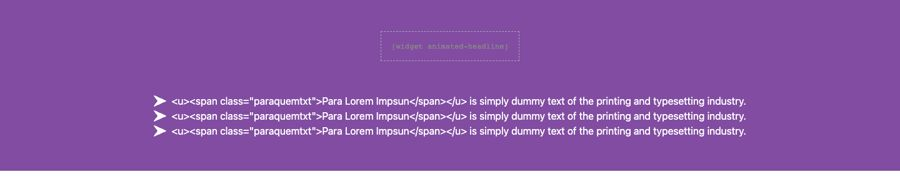
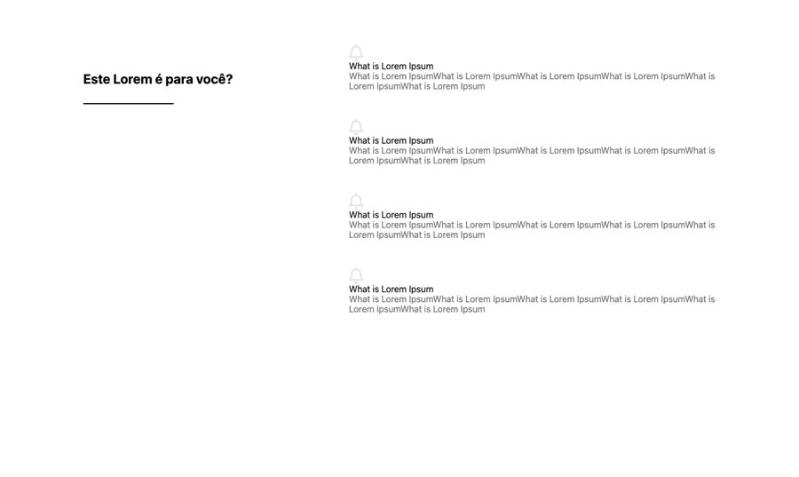
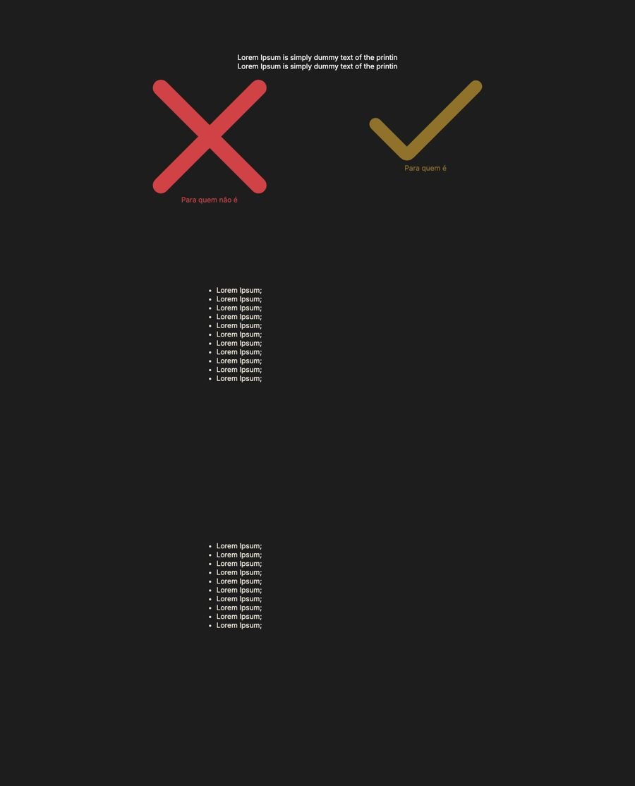
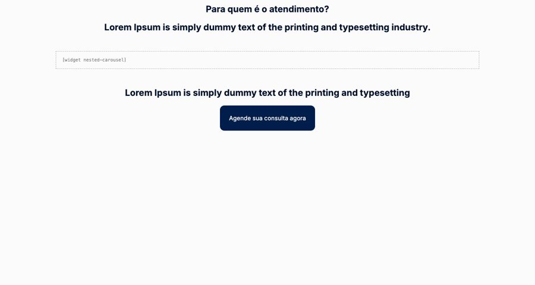

# Para quem é

**Propósito:** variações de seção do tipo "Para quem é" prontas para importar no Elementor.  
**Quando usar:** ao montar a dobra correspondente de uma página nova.  
**Relacionados:** [catalogo-secoes.md](../catalogo-secoes.md), [estrutura-de-pagina.md](<../../../copy/estrutura-de-pagina.md>), [anatomia-json-elementor.md](<../../anatomia-json-elementor.md>)

Importar: no Elementor, pasta de templates > Importar e escolher o `.json`; ou abrir o `.json`, copiar e usar "Colar de outro site" com os `content` convertidos. Os textos são Lorem Ipsum de modelo. O `.jpg` é uma pré-visualização aproximada gerada por `scripts/elementor-para-preview.py` (widgets de addons aparecem como caixa pontilhada).

## para-quem-e-lista-setas-fundo-roxo

- **Arquivo:** [para-quem-e-lista-setas-fundo-roxo.json](para-quem-e-lista-setas-fundo-roxo.json) (título no export: "quem 02")
- **Visual:** Fundo roxo; título animado (widget de addon) e lista de 3 itens com seta, com o público sublinhado.
- **Quando usar:** Bloco curto de "para quem é" em página de vendas.
- **Layout:** lista centralizada · **Estilo:** escuro · **Cor dominante:** `#814CA2` · **Nicho:** infoproduto
- **Widgets:** container (1), animated-headline (1), icon-list (1)

## para-quem-e-titulo-esquerda-4-itens-icone

- **Arquivo:** [para-quem-e-titulo-esquerda-4-itens-icone.json](para-quem-e-titulo-esquerda-4-itens-icone.json) (título no export: "quem 05")
- **Visual:** Fundo branco; título "Este Lorem é para você?" com filete à esquerda e 4 itens com ícone, título e texto à direita.
- **Quando usar:** Qualificar o público em captação ou vendas; padrão título à esquerda e conteúdo à direita.
- **Layout:** duas colunas (título | lista) · **Estilo:** claro · **Cor dominante:** `transparente` · **Nicho:** genérico
- **Widgets:** container (4), icon-box (4), heading (2), divider (1)

## para-quem-e-e-nao-e-x-e-check

- **Arquivo:** [para-quem-e-e-nao-e-x-e-check.json](para-quem-e-e-nao-e-x-e-check.json) (título no export: "PQE 9")
- **Visual:** Fundo cinza-escuro; dois grandes ícones (X vermelho "Para quem não é" e check dourado "Para quem é") com listas embaixo.
- **Quando usar:** Filtrar público em infoproduto ou mentoria.
- **Layout:** duas colunas comparativas · **Estilo:** escuro · **Cor dominante:** `#1D1D1D` · **Nicho:** infoproduto
- **Widgets:** container (5), image-box (3), text-editor (2)

## para-quem-e-carrossel-condicoes-com-cta

- **Arquivo:** [para-quem-e-carrossel-condicoes-com-cta.json](para-quem-e-carrossel-condicoes-com-cta.json) (título no export: "card 27")
- **Visual:** Fundo quase branco; título "Para quem é o atendimento?", subtítulo, carrossel de cards (nested-carousel) com as condições atendidas, frase e botão navy.
- **Quando usar:** Médicos e psicólogos listarem condições tratadas (usado em saude-pedro-camargo).
- **Layout:** carrossel · **Estilo:** claro · **Cor dominante:** `#FBFBFB` · **Nicho:** saúde / psiquiatria
- **Widgets:** container (22), icon-box (10), heading (3), nested-carousel (1), button (1)
