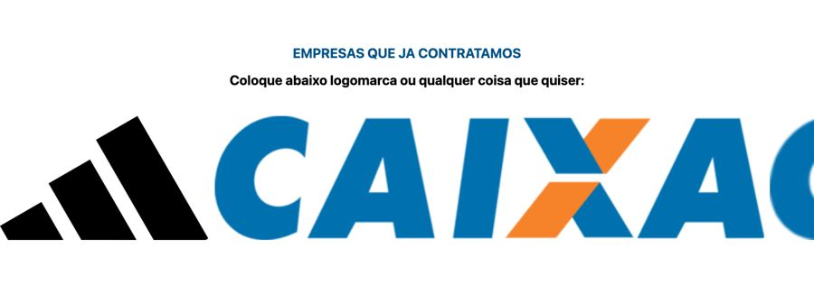

# Prova social

**Propósito:** variações de seção do tipo "Prova social" prontas para importar no Elementor.  
**Quando usar:** ao montar a dobra correspondente de uma página nova.  
**Relacionados:** [catalogo-secoes.md](../catalogo-secoes.md), [estrutura-de-pagina.md](<../../../copy/estrutura-de-pagina.md>), [anatomia-json-elementor.md](<../../anatomia-json-elementor.md>)

Importar: no Elementor, pasta de templates > Importar e escolher o `.json`; ou abrir o `.json`, copiar e usar "Colar de outro site" com os `content` convertidos. Os textos são Lorem Ipsum de modelo. O `.jpg` é uma pré-visualização aproximada gerada por `scripts/elementor-para-preview.py` (widgets de addons aparecem como caixa pontilhada).

## carrossel-logos-empresas

- **Arquivo:** [carrossel-logos-empresas.json](carrossel-logos-empresas.json) (título no export: "carrossel icon 01")
- **Visual:** Fundo branco; rótulo azul "EMPRESAS QUE JÁ CONTRATAMOS", subtítulo e carrossel de logos grandes.
- **Quando usar:** Prova social B2B por logos de clientes.
- **Layout:** carrossel horizontal · **Estilo:** claro · **Cor dominante:** `#FFFFFF` · **Nicho:** B2B
- **Widgets:** heading (2), container (1), image-carousel (1)
