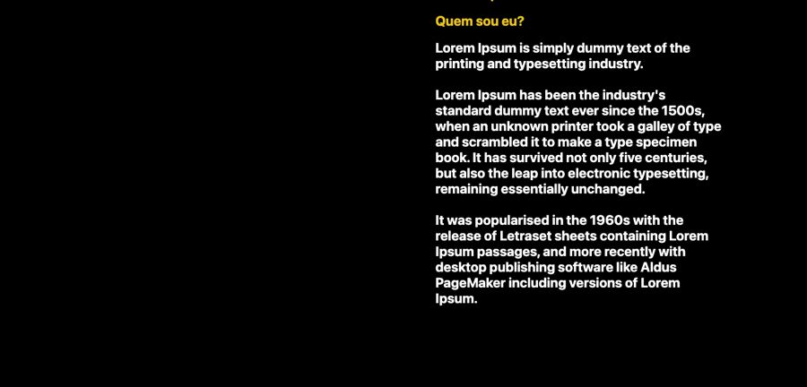
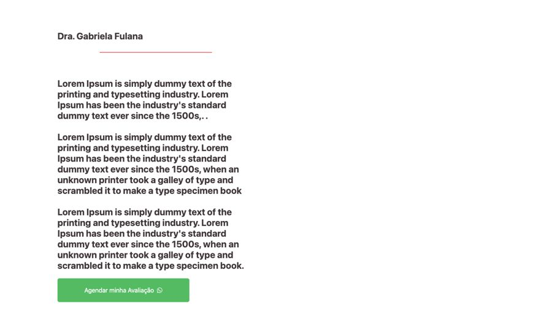
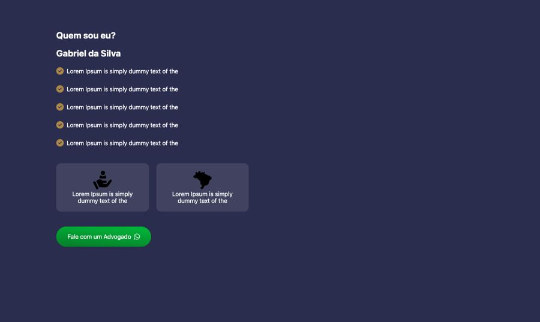

# Sobre o profissional

**Propósito:** variações de seção do tipo "Sobre o profissional" prontas para importar no Elementor.  
**Quando usar:** ao montar a dobra correspondente de uma página nova.  
**Relacionados:** [catalogo-secoes.md](../catalogo-secoes.md), [estrutura-de-pagina.md](<../../../copy/estrutura-de-pagina.md>), [anatomia-json-elementor.md](<../../anatomia-json-elementor.md>)

Importar: no Elementor, pasta de templates > Importar e escolher o `.json`; ou abrir o `.json`, copiar e usar "Colar de outro site" com os `content` convertidos. Os textos são Lorem Ipsum de modelo. O `.jpg` é uma pré-visualização aproximada gerada por `scripts/elementor-para-preview.py` (widgets de addons aparecem como caixa pontilhada).

## sobre-foto-fundo-texto-direita-escuro

- **Arquivo:** [sobre-foto-fundo-texto-direita-escuro.json](sobre-foto-fundo-texto-direita-escuro.json) (título no export: "quem sou eu 01")
- **Visual:** Fundo preto com foto do profissional à esquerda (imagem de fundo); à direita "Quem sou eu?" em amarelo e três parágrafos brancos.
- **Quando usar:** Bio em página escura.
- **Layout:** texto à direita sobre foto · **Estilo:** escuro · **Cor dominante:** `#000000` · **Nicho:** genérico
- **Widgets:** container (3), heading (3)

## sobre-texto-coluna-botao-verde

- **Arquivo:** [sobre-texto-coluna-botao-verde.json](sobre-texto-coluna-botao-verde.json) (título no export: "quem sou eu 02")
- **Visual:** Fundo branco; nome "Dra. Gabriela Fulana" com filete rosa, três parágrafos e botão verde "Agendar minha Avaliação" (foto à direita via fundo).
- **Quando usar:** Bio de dentista ou médica (usado em odonto-rubiane-vitali).
- **Layout:** coluna à esquerda · **Estilo:** claro · **Cor dominante:** `#FFFFFF` · **Nicho:** odonto / saúde
- **Widgets:** container (2), heading (2), divider (1), image (1), button (1)

## sobre-advogado-navy-checks-e-cards

- **Arquivo:** [sobre-advogado-navy-checks-e-cards.json](sobre-advogado-navy-checks-e-cards.json) (título no export: "qse 06")
- **Visual:** Fundo navy; "Quem sou eu?", nome, 5 itens com check dourado, 2 mini cards translúcidos com ícone e botão verde "Fale com um Advogado".
- **Quando usar:** Bio de advogado (usado em adv-gustavo-kehl).
- **Layout:** coluna à esquerda (foto ao lado) · **Estilo:** escuro · **Cor dominante:** `#2A2D4D` · **Nicho:** advocacia
- **Widgets:** icon-list (5), container (4), heading (2), icon-box (2), button (1)
