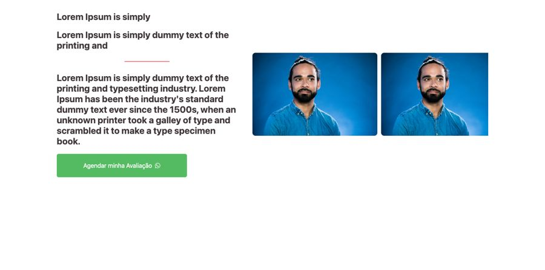
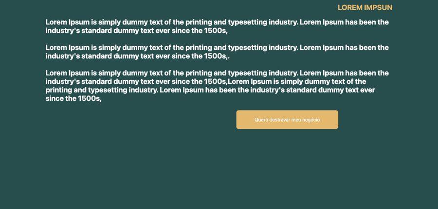
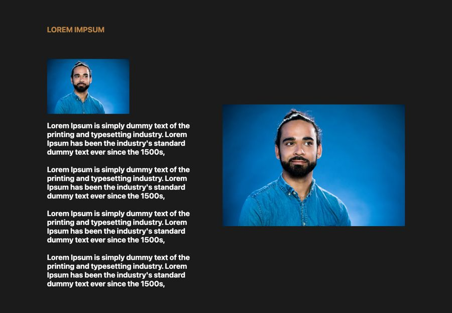

# Texto e imagem (solução, história)

**Propósito:** variações de seção do tipo "Texto e imagem (solução, história)" prontas para importar no Elementor.  
**Quando usar:** ao montar a dobra correspondente de uma página nova.  
**Relacionados:** [catalogo-secoes.md](../catalogo-secoes.md), [estrutura-de-pagina.md](<../../../copy/estrutura-de-pagina.md>), [anatomia-json-elementor.md](<../../anatomia-json-elementor.md>)

Importar: no Elementor, pasta de templates > Importar e escolher o `.json`; ou abrir o `.json`, copiar e usar "Colar de outro site" com os `content` convertidos. Os textos são Lorem Ipsum de modelo. O `.jpg` é uma pré-visualização aproximada gerada por `scripts/elementor-para-preview.py` (widgets de addons aparecem como caixa pontilhada).

## texto-esquerda-duas-fotos-direita-botao

- **Arquivo:** [texto-esquerda-duas-fotos-direita-botao.json](texto-esquerda-duas-fotos-direita-botao.json) (título no export: "texxto e imagem 01")
- **Visual:** Fundo branco; título, subtítulo, filete, parágrafo e botão verde à esquerda; duas fotos lado a lado à direita.
- **Quando usar:** Apresentação de solução, clínica ou método com fotos.
- **Layout:** duas colunas · **Estilo:** claro · **Cor dominante:** `#FFFFFF` · **Nicho:** genérico
- **Widgets:** heading (3), container (2), divider (1), button (1), image-carousel (1)

## bloco-texto-longo-fundo-verde-botao-dourado

- **Arquivo:** [bloco-texto-longo-fundo-verde-botao-dourado.json](bloco-texto-longo-fundo-verde-botao-dourado.json) (título no export: "texto e imagem 02")
- **Visual:** Fundo verde-petróleo; rótulo dourado, três parágrafos brancos em negrito e botão dourado "Quero destravar meu negócio".
- **Quando usar:** Bloco de argumento ou dor em texto corrido antes do CTA.
- **Layout:** coluna larga · **Estilo:** escuro · **Cor dominante:** `#284D4D` · **Nicho:** infoproduto / negócios
- **Widgets:** heading (2), container (1), button (1)

## texto-com-fotos-fundo-escuro

- **Arquivo:** [texto-com-fotos-fundo-escuro.json](texto-com-fotos-fundo-escuro.json) (título no export: "texto e imagem 03")
- **Visual:** Fundo cinza-escuro; rótulo laranja, foto pequena, quatro parágrafos à esquerda e foto grande à direita.
- **Quando usar:** História do autor ou storytelling em página de vendas.
- **Layout:** duas colunas · **Estilo:** escuro · **Cor dominante:** `#1B1B1B` · **Nicho:** infoproduto
- **Widgets:** container (2), heading (2), image (2)
